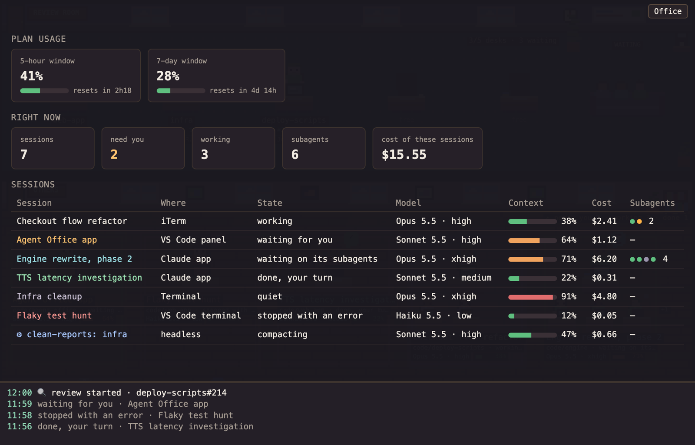

# Agent Office

A small macOS window that shows your Claude Code agents at work, as a pixel-art office.


*Demo data. Open `web/office.html` in a browser to see it live.*

See at a glance which session is **waiting for you**, which is working, which has finished, and what
its subagents are doing, without switching between terminals.

## Quick start

Needs macOS 13+, the Xcode command-line tools, `jq` and Claude Code.

```bash
git clone https://github.com/ArdaThePolat/agent-office.git
cd agent-office
scripts/build-app.sh                 # builds ~/Applications/Agent Office.app
scripts/install-hook.sh --dry-run    # shows the change to ~/.claude/settings.json
scripts/install-hook.sh              # registers the hook (keeps your existing hooks)
open ~/Applications/"Agent Office.app"
```

Sessions report from their next turn on; start a new Claude Code session (or send a message in an
open one) and it walks into the office.

### Or let your agent set it up

Run this in a terminal; Claude Code clones the repo and installs it, step by step:

```bash
claude "Clone https://github.com/ArdaThePolat/agent-office into ~/agent-office, then install Agent Office by following its AGENTS.md exactly. Show me the change to my Claude settings and ask me before applying it."
```

Using another coding agent? Paste the same sentence into it. [`AGENTS.md`](AGENTS.md) has the
steps with a check after each one, and the agent asks you before it touches your Claude settings
or your config.

Missing a prerequisite: `xcode-select --install` for the command-line tools, `brew install jq`.

## What you see

- **Others room**: every Claude Code session as a person at a desk, with its subagents at smaller
  desks below. Sessions in the same repo share a shirt and rug colour. They walk in through the
  door when a session starts and out when it ends. Under each one: its title, folder and state, and
  the model and effort of its latest reply (e.g. *Opus 5.5 · xhigh*).
- **Bubbles** say what each one needs:

  | bubble | means |
  |---|---|
  | **!** orange, blinking | waiting for your permission |
  | **✓** | done, your turn (for 30 minutes after its turn ends) |
  | **×** | its turn ended on an API error, often a network drop (for 30 minutes, then idle; send it a message to carry on) |
  | **hourglass** | its turn is over but subagents it started in the background are still running |
  | **…** | compacting its context |
  | **?** | quiet: working, but silent for over 10 minutes |
  | **z** | idle |

- **Manager's room** (optional, top left): you, at your desk. A screen on the wall counts the
  sessions that need you, are working or are done, with your weekly plan usage when
  the companion mod reports it; an orange **!** over your head when someone needs you. Under the
  desk: who needs you and who is working, your weekly usage as a battery that drains
  as you use it (orange, then red and blinking as they run low), when the week resets, and
  what the open sessions have cost. Click it
  for the stats screen. **✎ edit** under its window sets your name and picture (also in
  Settings, and Agent Office → Your Name and Picture…); the picture is copied next to the config,
  and a teammate in your shared room sees the change at once. Or set `manager` by hand (see
  *Configuration*). The weekly number is one for the whole account: each session reports the
  value from its own last reply, so the gauge shows the highest report for the current week.
- **Lounge**: where agents with nothing to do go. A session that has been idle (or done for over 30
  minutes) leaves its desk for the lounge and keeps itself busy there: it makes a coffee at the machine,
  drinks it at the kitchen table, plays on the console, chats at the high table, each agent in
  its own order, walking between spots. It walks back to a desk the moment it gets work. **Right-click → Release to the lounge** sends
  one there yourself and empties its desk; it comes back on its own when you send it a message,
  or with **Back to the desk**.
- **Review room** (optional): one desk per PR-review slot with repo, PR, owner and how long it has
  been running, and a sofa for the queue. See *Configuration*.
- **Log strip**: general events only (session waiting for you, done, subagent started / finished,
  review started / posted).

Hover an agent for details. **Click a session to bring it to the front where it runs:**

| started in | a click |
|---|---|
| Terminal, iTerm2 | selects that exact tab (and iTerm pane) |
| VS Code's Claude panel | brings that project's VS Code window forward and opens the session's tab in it |
| a VS Code terminal | brings that project's VS Code window forward (a terminal tab inside it cannot be picked from outside) |
| the Claude app | opens that session in the Claude app (`claude://code/continue?session=…`) |

VS Code (and Cursor, Windsurf, VSCodium) is found by the folder its window has open: the window
whose folder holds the session's directory. If no open window holds it, Agent Office falls back to
matching window titles, which needs **Accessibility** (System Settings → Privacy & Security →
Accessibility); without it the editor is just brought forward. The first click on a Terminal or
iTerm session asks once for permission to control that app. A review desk opens its PR.

Sessions already running when you install or update Agent Office learn where they run on their next
message.

**Right-click an agent** for *Open*, *Reveal folder*, *Copy session id*, *Release to the lounge* and *Hide from view*. A
hidden agent stays out of the office until something new happens to it (you send it a message, it
asks for a permission, its turn ends, it errors); then it walks back in. Right-click anywhere →
**Show hidden agents** brings them all back.

### Stats screen

**Stats** (top right, or press **S**) lists every session with where it runs, its state, model and
effort, how full its context is, what it has cost and its subagents' states, plus your plan usage
(the weekly window, and when it resets). Click a row to open that session.



### Companion mod (optional): context, cost, plan usage

The hook sees what a session does; only the session itself knows how full its context is, what it
costs, your plan usage and each subagent's exact state. The optional companion
[mod](https://code.claude.com/docs/en/plugins/mods/overview) in `mod/` reports those, and the office
shows them: a **context gauge** under each desk, **status dots** on subagents (running, waiting,
idle, failed), and the numbers on the stats screen. It also pins a one-line status under your
prompt in every session, e.g. `office: 2 need you (Flaky test hunt, Infra cleanup) · 3 working`.

```
/plugin install agent-office --marketplace ArdaThePolat/agent-office
```

(or `claude plugin install agent-office --marketplace ArdaThePolat/agent-office` from a shell).
Needs Claude Code 2.1.287 or later. It writes one small file per session under
`~/.local/state/agent-office/live/`, records no prompts or tool calls, and everything else works
without it.

### Shared room (optional): one lounge for the team

Teammates on the same office network can share their lounge. Everyone in the room appears in
everyone's lounge as their own pixel character, their name over their head, drinking coffee and
playing on the console, and the chat talks to the whole room. With a room set up the chat is a
fixed panel on the right of the others room, whether you are in the room or it is local right
now (the panel then says so, with **Try now**); in a narrow window it moves behind a **Chat**
button (or **C**). **Hide** (or **C**) folds it away and gives the desks the room back; a bell tab
stays on the right edge and rings, with the number of unread messages, when someone writes. Click
it (or **C**) to bring the chat back. Hidden or shown is remembered.

You are in the lounge too, as your own character, next to your teammates (two teammates in the
room is three people in your lounge). Click a piece of the lounge (the coffee machine, the
kitchen table, the high table, the sofa) and your character walks there and stays, in your
office and in everyone else's; click it again, or click your character, and it goes back to its
own routine.

Click a teammate for a menu: **Hug**, **Kiss**, **High five**, **Pillow fight**, **Bring a coffee**,
**Wave**, **Poke**, or **Chat**. Your character walks over and the two of you do it, in every lounge in the
room, and the log says so ("Alex hugged Jordan"). The lounge counts everyone in it, you included.

On the lounge's right side, a panel lists everyone in the room, you first. Click a name for the
same menu, or **👉 Poke** next to it: the person you poke gets a notification on their Mac and
their Agent Office window gives a little shake (with the window minimised, its Dock icon
bounces). You can poke the same person once every 20 seconds, and a person sees at most one poke
notification from the same teammate in 20 seconds. macOS asks once whether Agent Office may show
notifications. A teammate on an older version than this one does not get pokes. Without a room,
the panel has **Create a room** and **Join a room** buttons; **⋯** next to the room's name joins
another room, creates one, or leaves this one. The same three are in the **Room** menu. (In a
narrow window the panel is left out: use the Room menu.)

Only the people are shared. Your agents stay yours: your desks, your review room, your manager's
room, and your agents on a break in the lounge are drawn from your own sessions and are never
sent anywhere, so each person sees their own agents next to the shared teammates. Only you see
yourself in the manager's chair.

#### Create a room (one person, the host)

The quick way: **Create a room** in the lounge's panel (or Room → Create a Room…). Type a name and
a password of at least 8 characters, then pass both to your team over a private channel. The app
writes them to the `room` block of `~/.config/agent-office/config.json` (readable only by you) and
opens the room. Steps 4 and 6 below still apply. By hand:

1. Pick who hosts: a Mac that is on the office network and usually has Agent Office open. The
   room exists only while that app is open.
2. Make sure the host has a `manager` name (and picture, if they like) in
   `~/.config/agent-office/config.json`: that is their character in the room.
3. Add the room to the same file, with a long random password. This prints the password once,
   to pass on to the team (`team-lounge` is your room's name, pick any):

   ```bash
   cd ~/.config/agent-office && P=$(openssl rand -base64 18) && jq --arg p "$P" '.room = {name: "team-lounge", password: $p, host: true}' config.json > config.json.new && mv config.json.new config.json && echo "room password: $P"
   ```

4. Restart Agent Office. macOS asks whether it may accept incoming connections and find devices
   on the local network: allow both. The **Chat** button appears; it says *you host it*.
5. Send the room name and password to your team over a private channel.
6. Tick Settings → **Open at login**, so the room comes back by itself after you restart your Mac.
   The room's name and password stay in your config: closing and reopening the app hosts the same
   room, and your team's password keeps working.

#### Join a room (everyone else)

The quick way: **Join a room** in the lounge's panel (or Room → Join a Room…), then type the
room's name and password; the host's address is optional (see below). By hand:

1. Install or update Agent Office (`git pull`, then `scripts/build-app.sh`).
2. Set your character: `manager.name` and `manager.image` in `~/.config/agent-office/config.json`
   (see *Configuration*).
3. Add the room's name and password to `~/.config/agent-office/env`:

   ```bash
   printf 'AGENT_OFFICE_ROOM_NAME=team-lounge\nAGENT_OFFICE_ROOM_PASSWORD=<the password>\n' >> ~/.config/agent-office/env
   ```

   (or a `room` block with `name` and `password` in `config.json`, without `host`).
4. Restart Agent Office and allow it to find devices on the local network. Within a few seconds
   the host and everyone else in the room walk into your lounge; **Chat** shows who is there.
5. Not in the office, or the host's app closed? Your office is simply local, and it looks for the
   room again every 15 minutes (or click **Try now** in the chat panel).

**The chat says "the room is not on this network"?** Some networks hide devices from each other's
discovery (company Wi-Fi often does, and so does a VPN exit node, such as Tailscale's: turn on
**Allow Local Network Access** in its Exit Node menu, or turn the exit node off). Join by address
instead: the host's IP address (on the host: `ipconfig getifaddr en0`) or its `.local` name, in
the same env file:

```bash
printf 'AGENT_OFFICE_ROOM_ADDRESS=10.20.30.40\n' >> ~/.config/agent-office/env
```

The app still looks for the room by name first and tries the address after 3 seconds. The host
listens on port 48731 (`"port"` in the host's room block changes it; then add `:<port>` to the
address). An IP address can change when the host reconnects to the Wi-Fi; the `.local` name
does not, but it needs the same discovery some networks block. To check from a member's Mac
whether the host is reachable at all: `nc -vz <host address> 48731`.

To leave, untick Settings → **Join the shared room**.

#### Details

One Mac hosts the room (its Agent Office has to be open); everyone else needs only the room's
name and password. Set them in `~/.config/agent-office/config.json`:

```json
"manager": { "name": "Alex", "image": "~/agent-office/local/me.png" },
"room": { "name": "team-lounge", "password": "<long random password>", "host": true }
```

`host: true` on the host's Mac only. Or, on each member's Mac, in `~/.config/agent-office/env`
(an app opened from the Dock does not see your shell's exports; this file it reads):

```bash
AGENT_OFFICE_ROOM_NAME=team-lounge
AGENT_OFFICE_ROOM_PASSWORD=<the room's password>
```

- **Your character** is your `manager` picture and name. Without a picture you get a drawn one.
- **Joining:** the app looks for the room by name on the local network (Bonjour) when it starts,
  and again every 15 minutes while it is not in (`"alwaysJoin": false` looks only once; **Try
  now** in the chat panel looks at once). When the room goes away while you are in it (the host
  restarted its app or Mac), it looks again after 30 seconds and 2 minutes first, so everyone is
  back soon after the host is. If the room is not there, the office is simply local.
  The first time, macOS asks to let Agent Office find devices on the local network: allow it.
  On the host it also asks to accept incoming connections.
- **Turning it off:** Settings → **Join the shared room**, or `"enabled": false` in the `room`
  block (`AGENT_OFFICE_ROOM_ENABLED=0`).
- **What is shared:** your name, a small picture and your chat messages. Nothing about your
  sessions, folders or prompts. Messages are kept in each app's memory only, and are gone when
  it quits; someone who joins later does not see earlier ones.
- **Security:** the password never crosses the network. Each connection derives a key from it
  (HKDF-SHA256 over two fresh random values), proves it knows the password with that key, and
  encrypts everything after that with AES-GCM, so others on the same network cannot read the
  chat or join without it. Use a long random password: someone who records a join can try
  guesses against it offline. After three wrong passwords from one address the host ignores it
  for 10 minutes.

## Settings

Agent Office → Settings… (⌘,):
- **Your name and picture**: **Change…** opens the same editor as **✎ edit** in the manager's room.
- **Saved room** and **Delete Saved Room…**: a room you create or join is saved in
  `~/.config/agent-office/config.json` and joined (or hosted) again at every launch, until you
  join or create another one, or delete it here. Room → Leave the Room only pauses it and keeps
  the name and password; Delete removes both.
- **Import from env file…**: for a setup made with `~/.config/agent-office/env`. It moves the
  `AGENT_OFFICE_ROOM_…` and `AGENT_OFFICE_MANAGER_…` lines into `config.json` (it lists them first,
  the password only as its length) and takes them out of the env file, keeping a copy in
  `env.bak`. The first launch of a version with this does it by itself, once, without asking:
  after that your own edits stand and the env file is not read for an import again. The button
  is for env lines you add later. The env file wins over `config.json`, so until those lines are
  imported, the Room menu and Delete Saved Room cannot change a room they set (the app says so
  when you try).
- **Check for updates once a day** (off by default): see *Updating* below.
- **Join the shared room** (on by default, does nothing until a room is configured).
- **Open at login** (off by default): starts Agent Office when you log in. Turn it on on the Mac
  that hosts a room, so the room is back after a restart. macOS may ask you to approve it in
  System Settings → General → Login Items.

The rest are off by default:
- **Keep on top**: float the window above other apps and across Spaces.
- **Play a sound**: "Glass" when an agent waits for your permission, "Pop" when one finishes.
- **Energy saver**: 2 redraws a second instead of 6, no walking or blinking.

The window remembers its size and position. **Check Setup…** in the same menu says whether the
hook is registered for every event and when a session last reported.

## Updating

By hand: `git pull && scripts/build-app.sh` in your checkout, then reopen the app.

Or let the app do it: tick Settings → **Check for updates once a day**, or use Agent Office →
**Check for Updates…** once (when it finds a newer release, **Update Now** in its alert does the
same as the button). It asks GitHub for the repository's latest release and compares it
with the release your app was built from; when there is a newer one, an **Update to vX** button
appears at the top right. Clicking it:

1. fetches the release into the checkout the app was built from and moves it there with
   `git merge --ff-only <tag>`, so it never overwrites anything: local commits or uncommitted
   changes in the way stop the update with the reason and the manual command;
2. runs `scripts/build-app.sh` into the folder the app is in;
3. reopens the new app.

The steps are logged to `~/Library/Logs/agent-office-update.log`. The hook runs from the checkout,
so it is updated in the same move. The companion mod is a plugin and updates through Claude Code.

## Configuration

Optional: `~/.config/agent-office/config.json`. Everything specific to your setup lives in this
file, not in the repository. Every key is optional.

```json
{ "officeState": "~/.local/state/agent-office",
  "manager": { "name": "Alex", "image": "~/agent-office/local/manager.png" },
  "room": { "name": "team-lounge", "password": "<password>", "host": false, "alwaysJoin": true,
            "address": "10.20.30.40" },
  "reviews": { "state": "~/.local/state/pr-watch", "log": "~/Library/Logs/pr-watch.log",
               "slots": 5, "bitbucketWorkspace": "<workspace>" },
  "sessionKinds": [
    { "startsWith": "You are running the automated PR review", "kind": "review",
      "repoAfter": "for the repo '", "title": "PR review: {repo}" },
    { "startsWith": "You maintain the list of known defects", "kind": "automation",
      "repoAfter": "for the repo '", "title": "clean-reports: {repo}" } ] }
```

- **`room`** shares your lounge with your team: see *Shared room* above.
- **`manager`** adds the manager's room. `image` is any picture of you (PNG, JPEG, WebP…). A plain
  white or transparent background is cut away and the rest redrawn as pixel art, so a pixel-art
  avatar looks best. `name` goes on the desk's name plate. With a name and no image, a drawn
  manager sits there. `local/` in the repository is ignored by git: a good place to keep the
  picture. `AGENT_OFFICE_MANAGER_IMAGE` and `AGENT_OFFICE_MANAGER_NAME` override both keys.
- **`reviews`** feeds the review room from a PR reviewer that keeps:
  - `<state>/running/<repo>-<pr>`: one tab-separated line per review in progress (repo name, repo
    slug, PR number, commit, author, start time `HH:MM`, pid, title);
  - `<state>/queue`: one line per waiting PR (repo name, slug, number, commit, author,
    `auto`/`manual`, title);
  - a log whose lines look like `YYYY-MM-DD HH:MM:SS [pr-watch] <repo>#<pr>: …`.

  `bitbucketWorkspace` makes a review desk link to its Bitbucket PR. Without a `reviews` block the
  review room stays empty.
- **`sessionKinds`** tells headless jobs apart from your own sessions by how their first prompt
  starts.
  - `kind` is `review` (drawn at a review desk) or `automation` (⚙ in the others room).
  - `repoAfter`, and `repoEnd` (default `'`), cut a repo name out of the prompt for `{repo}` in
    `title`.
  - Sessions that match no entry are your own, titled from the Claude app or their folder.

## How it works

```
Claude Code ──hook──▶ ~/.local/state/agent-office/sessions/<id>.json  ─┐
                       ~/.local/state/agent-office/events.log           ├─▶ Agent Office.app (reads every 2 s
PR reviewer ─────────▶ <reviews state>/running/*, queue, log file ─────┘    while its window is visible)
```

- **`hook/agent-office-hook.sh`** is a Claude Code hook.
  - It keeps one small JSON file per session: title, folder, state, subagents, model, effort, and
    the Claude process id.
  - It appends general events to a log.
  - It always exits 0, prints nothing, and on the frequent "tool finished" event returns after a
    single `grep`.
- **`app/AgentOffice.swift`** is the window: a WKWebView around `web/office.html`.
  - It drops a session whose Claude process is gone, so a crashed session never lingers.
  - Without a shared room there is no server and no port, and nothing runs while the window is
    closed.
- **`app/Room.swift`** is the shared room: the host (a WebSocket listener advertised with
  Bonjour) and the member connection, with the handshake and encryption described in its header.
- **`web/office.html`** is the office, drawn in code. Opened in a browser on its own, it shows demo
  data.

## Privacy and cost

- **What is recorded:** states only. No prompt text, tool names or arguments are recorded. The first
  prompt is read only to match `sessionKinds`, and the transcript only for the latest model and
  effort. Where a session runs (the app, its terminal device) is recorded so a click can open it.
  With the companion mod, each session's context use, cost, plan usage and subagent states too.
  Everything stays on your Mac, under `~/.local/state/agent-office/`. The one exception is the
  optional shared room, which sends your name, picture and chat messages to the room.
- **CPU and memory:** the app runs at background priority and reads its state only while its window
  is visible. It redraws at most 6 times a second (none while hidden) and draws at most 30 sessions;
  walls, floors and furniture are painted once and cached. Measured on an M-series Mac with the
  window visible: about 4% of one core and about 55 MB of memory.

## Uninstall

```bash
scripts/install-hook.sh --uninstall           # removes exactly the hook entries it added
claude plugin uninstall agent-office          # the companion mod, if you installed it
rm -rf ~/Applications/"Agent Office.app"
rm -rf ~/.local/state/agent-office            # session files and the event log
```

## Debugging

- `"$HOME/Applications/Agent Office.app/Contents/MacOS/AgentOffice" --dump-snapshot` prints exactly
  what the window is given.
- `"$HOME/Applications/Agent Office.app/Contents/MacOS/AgentOffice" --check-room` prints the room
  settings the app sees (config.json, the env file and the environment together; the password
  only as its length) and whether it will join.
- `ls ~/.local/state/agent-office/sessions/` should hold one file per running session; if it is
  empty, check **Check Setup…** and that `jq` is installed (the hook needs it).
- Open `web/office.html` in a browser to see the demo.

## License

[MIT](LICENSE)
