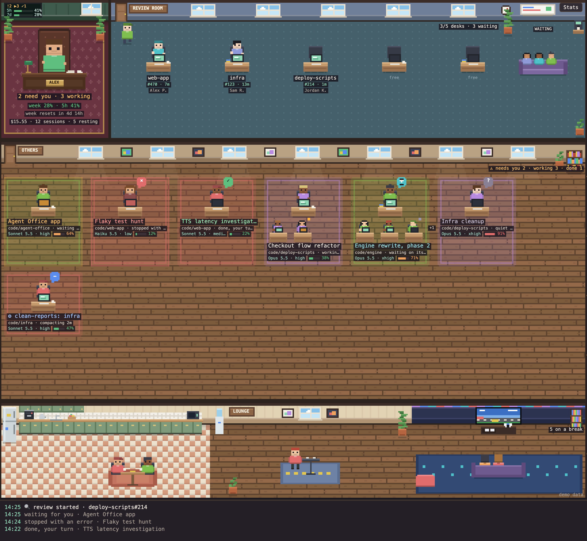

# Agent Office

A small macOS window that shows your Claude Code agents at work, as a pixel-art office.



*Demo data. Open `web/office.html` in a browser to see it live.*

See at a glance which session is **waiting for you**, which is working, which has finished, and what
its subagents are doing, without switching between terminals.

## Quick start

Needs macOS 13+, the Xcode command-line tools, `jq` and Claude Code.

```bash
git clone https://github.com/ArdaThePolat/agent-office.git
cd agent-office
scripts/build-app.sh                 # builds ~/Applications/Agent Office.app
scripts/install-hook.sh --dry-run    # shows the change to ~/.claude/settings.json
scripts/install-hook.sh              # registers the hook (keeps your existing hooks)
open ~/Applications/"Agent Office.app"
```

Sessions report from their next turn on; start a new Claude Code session (or send a message in an
open one) and it walks into the office.

### Or let your agent set it up

Run this in a terminal; Claude Code clones the repo and installs it, step by step:

```bash
claude "Clone https://github.com/ArdaThePolat/agent-office into ~/agent-office, then install Agent Office by following its AGENTS.md exactly. Show me the change to my Claude settings and ask me before applying it."
```

Using another coding agent? Paste the same sentence into it. [`AGENTS.md`](AGENTS.md) has the
steps with a check after each one, and the agent asks you before it touches your Claude settings
or your config.

Missing a prerequisite: `xcode-select --install` for the command-line tools, `brew install jq`.

## What you see

- **Others room**: every Claude Code session as a person at a desk, with its subagents at smaller
  desks below. Sessions in the same repo share a shirt and rug colour. They walk in through the
  door when a session starts and out when it ends. Under each one: its title, folder and state, and
  the model and effort of its latest reply (e.g. *Opus 5.5 · xhigh*).
- **Bubbles** say what each one needs:

  | bubble | means |
  |---|---|
  | **!** orange, blinking | waiting for your permission |
  | **✓** | done, your turn (for 30 minutes after its turn ends) |
  | **×** | stopped with an error |
  | **hourglass** | its turn is over but subagents it started in the background are still running |
  | **…** | compacting its context |
  | **?** | quiet: working, but silent for over 10 minutes |
  | **z** | idle |

- **Manager's room** (optional, top left): you, at your desk. A screen on the wall counts the
  sessions that need you, are working or are done, with your plan usage (5-hour and 7-day) when
  the companion mod reports it; an orange **!** over your head when someone needs you. Under the
  desk: who needs you and who is working, your weekly and 5-hour usage with when the week
  resets, and what the open sessions have cost. Click it
  for the stats screen. Set it up with `manager` under *Configuration*.
- **Lounge**: where agents with nothing to do go. A session that has been idle (or done for over 30
  minutes) leaves its desk for the lounge and keeps itself busy there: it makes a coffee at the machine,
  drinks it at the kitchen table, plays on the console, chats at the high table, each agent in
  its own order, walking between spots. It walks back to a desk the moment it gets work. **Right-click → Release to the lounge** sends
  one there yourself and empties its desk; it comes back on its own when you send it a message,
  or with **Back to the desk**.
- **Review room** (optional): one desk per PR-review slot with repo, PR, owner and how long it has
  been running, and a sofa for the queue. See *Configuration*.
- **Log strip**: general events only (session waiting for you, done, subagent started / finished,
  review started / posted).

Hover an agent for details. **Click a session to bring it to the front where it runs:**

| started in | a click |
|---|---|
| Terminal, iTerm2 | selects that exact tab (and iTerm pane) |
| VS Code's Claude panel | brings that project's VS Code window forward and opens the session's tab in it |
| a VS Code terminal | brings that project's VS Code window forward (a terminal tab inside it cannot be picked from outside) |
| the Claude app | opens that session in the Claude app (`claude://code/continue?session=…`) |

VS Code (and Cursor, Windsurf, VSCodium) is found by the folder its window has open: the window
whose folder holds the session's directory. If no open window holds it, Agent Office falls back to
matching window titles, which needs **Accessibility** (System Settings → Privacy & Security →
Accessibility); without it the editor is just brought forward. The first click on a Terminal or
iTerm session asks once for permission to control that app. A review desk opens its PR.

Sessions already running when you install or update Agent Office learn where they run on their next
message.

**Right-click an agent** for *Open*, *Reveal folder*, *Copy session id*, *Release to the lounge* and *Hide from view*. A
hidden agent stays out of the office until something new happens to it (you send it a message, it
asks for a permission, its turn ends, it errors); then it walks back in. Right-click anywhere →
**Show hidden agents** brings them all back.

### Stats screen

**Stats** (top right, or press **S**) lists every session with where it runs, its state, model and
effort, how full its context is, what it has cost and its subagents' states, plus your plan usage
(5-hour and 7-day windows, when they reset). Click a row to open that session.


### Companion mod (optional): context, cost, plan usage

The hook sees what a session does; only the session itself knows how full its context is, what it
costs, your plan usage and each subagent's exact state. The optional companion
[mod](https://code.claude.com/docs/en/plugins/mods/overview) in `mod/` reports those, and the office
shows them: a **context gauge** under each desk, **status dots** on subagents (running, waiting,
idle, failed), and the numbers on the stats screen. It also pins a one-line status under your
prompt in every session, e.g. `office: 2 need you (Flaky test hunt, Infra cleanup) · 3 working`.

```
/plugin install agent-office --marketplace ArdaThePolat/agent-office
```

(or `claude plugin install agent-office --marketplace ArdaThePolat/agent-office` from a shell).
Needs Claude Code 2.1.287 or later. It writes one small file per session under
`~/.local/state/agent-office/live/`, records no prompts or tool calls, and everything else works
without it.

## Settings

Agent Office → Settings… (⌘,), all off by default:
- **Keep on top**: float the window above other apps and across Spaces.
- **Play a sound**: "Glass" when an agent waits for your permission, "Pop" when one finishes.
- **Energy saver**: 2 redraws a second instead of 6, no walking or blinking.

The window remembers its size and position. **Check Setup…** in the same menu says whether the
hook is registered for every event and when a session last reported.

## Configuration

Optional: `~/.config/agent-office/config.json`. Everything specific to your setup lives in this
file, not in the repository. Every key is optional.

```json
{ "officeState": "~/.local/state/agent-office",
  "manager": { "name": "Alex", "image": "~/agent-office/local/manager.png" },
  "reviews": { "state": "~/.local/state/pr-watch", "log": "~/Library/Logs/pr-watch.log",
               "slots": 5, "bitbucketWorkspace": "<workspace>" },
  "sessionKinds": [
    { "startsWith": "You are running the automated PR review", "kind": "review",
      "repoAfter": "for the repo '", "title": "PR review: {repo}" },
    { "startsWith": "You maintain the list of known defects", "kind": "automation",
      "repoAfter": "for the repo '", "title": "clean-reports: {repo}" } ] }
```

- **`manager`** adds the manager's room. `image` is any picture of you (PNG, JPEG, WebP…). A plain
  white or transparent background is cut away and the rest redrawn as pixel art, so a pixel-art
  avatar looks best. `name` goes on the desk's name plate. With a name and no image, a drawn
  manager sits there. `local/` in the repository is ignored by git: a good place to keep the
  picture. `AGENT_OFFICE_MANAGER_IMAGE` and `AGENT_OFFICE_MANAGER_NAME` override both keys.
- **`reviews`** feeds the review room from a PR reviewer that keeps:
  - `<state>/running/<repo>-<pr>`: one tab-separated line per review in progress (repo name, repo
    slug, PR number, commit, author, start time `HH:MM`, pid, title);
  - `<state>/queue`: one line per waiting PR (repo name, slug, number, commit, author,
    `auto`/`manual`, title);
  - a log whose lines look like `YYYY-MM-DD HH:MM:SS [pr-watch] <repo>#<pr>: …`.

  `bitbucketWorkspace` makes a review desk link to its Bitbucket PR. Without a `reviews` block the
  review room stays empty.
- **`sessionKinds`** tells headless jobs apart from your own sessions by how their first prompt
  starts.
  - `kind` is `review` (drawn at a review desk) or `automation` (⚙ in the others room).
  - `repoAfter`, and `repoEnd` (default `'`), cut a repo name out of the prompt for `{repo}` in
    `title`.
  - Sessions that match no entry are your own, titled from the Claude app or their folder.

## How it works

```
Claude Code ──hook──▶ ~/.local/state/agent-office/sessions/<id>.json  ─┐
                       ~/.local/state/agent-office/events.log           ├─▶ Agent Office.app (reads every 2 s
PR reviewer ─────────▶ <reviews state>/running/*, queue, log file ─────┘    while its window is visible)
```

- **`hook/agent-office-hook.sh`** is a Claude Code hook.
  - It keeps one small JSON file per session: title, folder, state, subagents, model, effort, and
    the Claude process id.
  - It appends general events to a log.
  - It always exits 0, prints nothing, and on the frequent "tool finished" event returns after a
    single `grep`.
- **`app/AgentOffice.swift`** is the window: a WKWebView around `web/office.html`.
  - It drops a session whose Claude process is gone, so a crashed session never lingers.
  - There is no server and no port, and nothing runs while the window is closed.
- **`web/office.html`** is the office, drawn in code. Opened in a browser on its own, it shows demo
  data.

## Privacy and cost

- **What is recorded:** states only. No prompt text, tool names or arguments are recorded. The first
  prompt is read only to match `sessionKinds`, and the transcript only for the latest model and
  effort. Where a session runs (the app, its terminal device) is recorded so a click can open it.
  With the companion mod, each session's context use, cost, plan usage and subagent states too.
  Everything stays on your Mac, under `~/.local/state/agent-office/`.
- **CPU and memory:** the app runs at background priority and reads its state only while its window
  is visible. It redraws at most 6 times a second (none while hidden) and draws at most 30 sessions;
  walls, floors and furniture are painted once and cached. Measured on an M-series Mac with the
  window visible: about 4% of one core and about 55 MB of memory.

## Uninstall

```bash
scripts/install-hook.sh --uninstall           # removes exactly the hook entries it added
claude plugin uninstall agent-office          # the companion mod, if you installed it
rm -rf ~/Applications/"Agent Office.app"
rm -rf ~/.local/state/agent-office            # session files and the event log
```

## Debugging

- `"$HOME/Applications/Agent Office.app/Contents/MacOS/AgentOffice" --dump-snapshot` prints exactly
  what the window is given.
- `ls ~/.local/state/agent-office/sessions/` should hold one file per running session; if it is
  empty, check **Check Setup…** and that `jq` is installed (the hook needs it).
- Open `web/office.html` in a browser to see the demo.

## License

[MIT](LICENSE)
